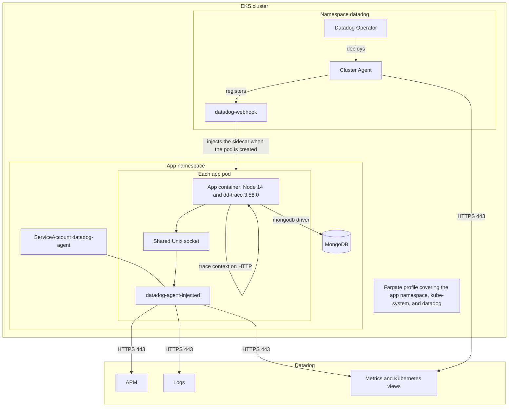
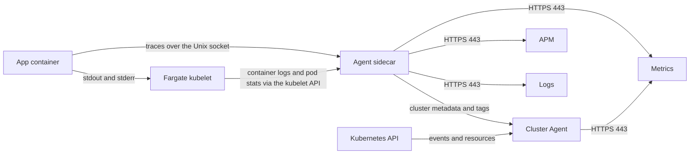

# Datadog on Amazon EKS Fargate for Node.js 14

Deployment guide for Datadog APM, infrastructure metrics, and native log collection on an EKS cluster that runs only on Fargate. Written so an AI assistant can apply it to another account. Manifests are in `k8s/`. The values in those files are from the validation lab. Change the fields in [What to change for your environment](#what-to-change-for-your-environment) before applying them.

The reference application is one Node.js 14 image with three roles:

```text
loadgen -> gateway (Express) -> parse-api (Parse Server, Cloud Code) -> MongoDB
                                         \-> inventory (Express)
```

## What to change for your environment

The files under `k8s/` run the validation lab. Applying them unchanged points Datadog at cluster `dd-node14-poc` and installs everything into the namespace `default`. The app image is not in the manifests. Copy `.env.example` to `.env` and set `IMAGE`. `.env` is gitignored.

Change these before `kubectl apply`. The API key is not in any file. Create it as the secret in the deploy steps.

| Change | File and field | Value in this repo | Set it to |
|---|---|---|---|
| Cluster name | `k8s/datadog-agent.yaml` `spec.global.clusterName` | `dd-node14-poc` | The EKS cluster name. This becomes `kube_cluster_name` on metrics |
| Datadog site | `k8s/datadog-agent.yaml` `spec.global.site` | `datadoghq.com` (US1) | The site the customer's Datadog account is on |
| App image | `IMAGE` in `.env` (copy from `.env.example`). `k8s/apps.yaml` uses `${IMAGE}` on `gateway`, `parse-api`, and `inventory` | Unset until you create `.env` | An image built from `app/` and pushed to a registry this cluster can pull. All three containers use the same image |
| App namespace | `namespace: default` on every object in `k8s/apps.yaml`, and on the ServiceAccount and the ClusterRoleBinding subject in `k8s/datadog-rbac.yaml` | `default` | The namespace the app pods run in. The secret, the ServiceAccount, and the pods must share it. `APP_NAMESPACE` in the deploy steps has to be that same namespace |
| Environment tag | `tags.datadoghq.com/env` and `DD_ENV` in `k8s/apps.yaml` | `poc` | The customer's environment, such as `prod` or `staging`. Use one value in both places |
| API key | Not stored in the repo | None | `datadog-secret` key `api-key`, in the `datadog` namespace and in the app namespace |

Outside the files, the cluster needs a Fargate profile that includes the app namespace, `kube-system`, and `datadog`, plus outbound HTTPS to the Datadog site and to the registry.

### When the customer deploys their own services

Do not apply `k8s/apps.yaml`. That file is the reference demo (Express gateway, Parse Server, MongoDB, load generator). On each of their Deployments, copy the pod-template settings from [How each feature is turned on](#how-each-feature-is-turned-on):

- Label `agent.datadoghq.com/sidecar: fargate` on the pod template.
- `serviceAccountName: datadog-agent`.
- Log annotation `ad.datadoghq.com/<container-name>.logs`. The container name in the key must match the container.
- `DD_ENV`, `DD_SERVICE`, `DD_VERSION`, and `DD_LOGS_INJECTION`.
- The same `env`, `service`, and `version` as pod labels `tags.datadoghq.com/env`, `/service`, and `/version`.
- Dependency `dd-trace` `3.58.0` and start command `node -r dd-trace/init`.
- CPU and memory `requests`. Fargate sizes the pod from those.

Still apply `k8s/datadog-agent.yaml` and `k8s/datadog-rbac.yaml` after the cluster-name, site, and namespace edits above. One `DatadogAgent` covers the cluster. Repeat the RBAC ServiceAccount in each namespace that runs an injected pod, and create `datadog-secret` in each of those namespaces.

For MongoDB Atlas, set the app's connection string to `mongodb+srv://...` and allow the NAT gateway address in the Atlas IP access list. Tracing does not change.

Leave these as they are: the secret name `datadog-secret`, the keys `api-key` and `token`, `provider: fargate`, the sidecar label, and the log-collection env vars in `k8s/datadog-agent.yaml`. Do not set `DD_AGENT_HOST` or `DD_TRACE_AGENT_URL` on the app container.

## What was tested

End-to-end distributed tracing works on this stack. One `/checkout` trace contains spans from `gateway`, `parse-api`, and `inventory`, plus `mongodb.query` spans for insert, find, and update. The Service Map shows `gateway -> parse-api -> {parse-api-mongodb, inventory}`. An `/error` request flags the error on the inventory span, with a stack trace, and that error propagates to the callers. Pod and container metrics from the Fargate sidecar carry the same `service` and `env` tags. Native log collection (no Fluent Bit) is on, including log-to-trace correlation for Parse Server's winston logs.

| Component | Version tested | Notes |
|---|---|---|
| Node.js | 14.21.3 | End of life upstream. Image `node:14.21.3-bullseye-slim` |
| `dd-trace` | 3.58.0 | npm tag `latest-node14`. v4 needs Node 16+, v5 needs Node 18+ |
| Parse Server | 6.5.11 | Parse Server 3.x was not deployed. See [Caveats](#caveats) |
| Express / axios | 4.21.1 / 0.27.2 | |
| MongoDB driver | 4.10.0 | Bundled with Parse Server 6 |
| MongoDB | 6.x in-cluster | Client-side spans are the same against MongoDB Atlas |
| Amazon EKS | 1.37 | Fargate only, no EC2 nodes |
| Datadog Agent and Cluster Agent | 7.84.1 | Native Fargate logs need Agent 7.71.0+ |
| Datadog Operator | current Helm chart | Installed once per cluster |

## Setup

On Fargate there is no node to put a DaemonSet on. The Operator deploys the Cluster Agent. The Cluster Agent's admission webhook injects an Agent sidecar into each pod labeled `agent.datadoghq.com/sidecar: fargate`. The tracer in the app container sends traces to that sidecar over a Unix socket on a shared volume. The webhook sets `DD_TRACE_AGENT_URL` to `unix:///var/run/datadog/apm.socket`.



## Telemetry flow



Traces move from the app to the sidecar. Logs and pod stats move from the kubelet to the sidecar. The Cluster Agent adds cluster metadata. All three signals leave the cluster over HTTPS 443.

## Requirements

### Cluster

| Requirement | Why |
|---|---|
| A Fargate profile on the app namespace, `kube-system`, and `datadog` | Pods in a namespace with no profile stay `Pending` |
| Private subnets with a NAT gateway, or VPC endpoints | Pods need outbound HTTPS for images and for Datadog |
| CoreDNS running on Fargate | Service discovery. Restart CoreDNS if it was created before the profile existed |
| A registry the cluster can pull from | The app image. The Agent image comes from `registry.datadoghq.com` |
| Outbound HTTPS 443 to the Datadog site | Trace, log, and metric intake |

### Datadog

| Requirement | Where it is used |
|---|---|
| API key | Kubernetes secret `datadog-secret`, key `api-key` |
| Cluster Agent token, 32 alphanumeric characters | Same secret, key `token`. Generate with `openssl rand -hex 16` |
| Datadog site | `DD_SITE`. `datadoghq.com` is US1. Use the site the account is on |

The secret must exist in the `datadog` namespace and in every namespace that runs an injected pod. The sidecar reads the secret in its own namespace.

### Tools, once per cluster

`kubectl` pointed at the cluster, Helm 3, `openssl`, and `envsubst` (gettext). Application teams do not need these. Their change is the pod label, the ServiceAccount, the tracer, and the env vars, shipped through CI.

## How each feature is turned on

Cluster-wide switches live in `k8s/datadog-agent.yaml`. Per-service settings live on the pod template and in the image.

| Feature | Where | Setting |
|---|---|---|
| Sidecar injection | `DatadogAgent` | `features.admissionController.agentSidecarInjection.enabled: true` and `provider: fargate` |
| Sidecar injection | Pod template label | `agent.datadoghq.com/sidecar: fargate` |
| Sidecar RBAC | Pod spec | `serviceAccountName: datadog-agent`, bound to ClusterRole `datadog-agent-fargate` |
| Pod and container metrics | Sidecar | On once the sidecar is injected. Needs the RBAC above |
| Kubernetes views and events | Cluster Agent | On with the Operator |
| APM | Image | `"dd-trace": "3.58.0"` and start with `node -r dd-trace/init` |
| APM intake | Sidecar | On by default. The webhook sets `DD_TRACE_AGENT_URL` |
| Distributed tracing | Tracer | Header propagation on HTTP in and out. No extra setting |
| MongoDB query spans | Tracer | Automatic for the `mongodb` driver |
| Unified service tagging | Env and labels | `DD_ENV`, `DD_SERVICE`, `DD_VERSION`, and labels `tags.datadoghq.com/env`, `/service`, `/version` |
| Native logs | Cluster Agent env | `DD_ADMISSION_CONTROLLER_AGENT_SIDECAR_KUBELET_API_LOGGING_ENABLED=true` |
| Native logs | Sidecar profile | `DD_LOGS_CONFIG_CONTAINER_COLLECT_ALL=true` |
| Drop the sidecar's own logs | Sidecar profile | `DD_CONTAINER_EXCLUDE_LOGS=name:datadog-agent-injected` |
| Log source and multi-line | Pod annotation | `ad.datadoghq.com/<container>.logs` with `source`, `service`, and `auto_multi_line_detection` |
| Log-to-trace correlation | App env | `DD_LOGS_INJECTION=true`. Works for winston, pino, and bunyan. Parse Server logs through winston. `console.log` is collected and has no trace id |
| Keep every trace | App env | `DD_TRACE_SAMPLE_RATE=1` for a validation run. Lower it in production |
| Name a Cloud function | Cloud Code | `require('dd-trace').scope().active()?.setTag('parse.function', request.functionName)` |

Per-service pod template:

```yaml
metadata:
  labels:
    agent.datadoghq.com/sidecar: fargate
    tags.datadoghq.com/env: <env>
    tags.datadoghq.com/service: <service>
    tags.datadoghq.com/version: "<version>"
  annotations:
    ad.datadoghq.com/<container>.logs: '[{"source":"nodejs","service":"<service>","auto_multi_line_detection":true}]'
spec:
  serviceAccountName: datadog-agent
  containers:
    - name: <container>    # must match the annotation key
      env:
        - { name: DD_ENV, value: <env> }
        - { name: DD_SERVICE, value: <service> }
        - { name: DD_VERSION, value: "<version>" }
        - { name: DD_LOGS_INJECTION, value: "true" }
```

The reference image loads the tracer first: `CMD ["node", "-r", "dd-trace/init", ...]`. No application code change is required for tracing.

## Deploy

### 1. Cluster setup, once

Edit the fields in [What to change for your environment](#what-to-change-for-your-environment) first. `APP_NAMESPACE` below must be the same namespace written into `k8s/datadog-rbac.yaml` and `k8s/apps.yaml`.

```sh
export DD_API_KEY=<Datadog API key>
export APP_NAMESPACE=<app namespace>

helm repo add datadog https://helm.datadoghq.com
helm install datadog-operator datadog/datadog-operator -n datadog --create-namespace

TOKEN=$(openssl rand -hex 16)
for ns in datadog "$APP_NAMESPACE"; do
  kubectl create namespace "$ns" --dry-run=client -o yaml | kubectl apply -f -
  kubectl -n "$ns" create secret generic datadog-secret \
    --from-literal api-key="$DD_API_KEY" --from-literal token="$TOKEN" \
    --dry-run=client -o yaml | kubectl apply -f -
done
unset DD_API_KEY TOKEN

kubectl apply -n datadog -f k8s/datadog-agent.yaml
kubectl -n datadog rollout status deploy/datadog-cluster-agent
kubectl apply -f k8s/datadog-rbac.yaml
```

`k8s/datadog-rbac.yaml` creates ClusterRole `datadog-agent-fargate` and ServiceAccount `datadog-agent`. The `DatadogAgent` registers `datadog-webhook`. Pods created before that webhook exists do not get a sidecar. Restart them after this step, and again after any change to the `DatadogAgent`.

### 2. Application image and workloads

Build for `linux/amd64` unless the Fargate profile runs arm64. Set that image as `IMAGE` in `.env`. Skip this apply when the customer is instrumenting their own Deployments.

```sh
cp .env.example .env   # then set IMAGE
set -a; source .env; set +a
docker buildx build --platform linux/amd64 -t "$IMAGE" --push app
envsubst '${IMAGE}' < k8s/apps.yaml | kubectl apply -f -
```

`k8s/apps.yaml` deploys `gateway`, `parse-api`, `inventory`, MongoDB, and a load generator. For a real service, keep the label, ServiceAccount, annotation, and env vars from the snippet above and point the image at that service.

### 3. Check

```sh
kubectl get pods
# App pods are 2/2: the app container and datadog-agent-injected

kubectl exec deploy/<service> -c datadog-agent-injected -- agent status
# APM Agent: traces received from nodejs, client 3.58.0
# Logs Agent: LogsSent, source nodejs
```

In Datadog, filter on `env:<env>`:

- Each service is listed with runtime Node.js 14.
- A single trace covers the services in the call, including MongoDB spans.
- The Service Map includes the database service `<service>-mongodb`.
- Errors are flagged on the failing span and on its callers.
- Logs are `service:<service>` and `source:nodejs`. A multi-line stack is one log. Parse Server logs link to the trace.
- Infrastructure shows the Fargate pods and containers for `kube_cluster_name:<cluster name>`.

To force one trace to be kept during validation, send `x-datadog-trace-id`, `x-datadog-parent-id`, and `x-datadog-sampling-priority: 2` on a request to `gateway`.

## Caveats

1. `dd-trace` v3 has had no fixes since May 2024. It runs on Node.js 14. Plan a move to Node.js 18 or newer to use a supported tracer.
2. Parse Server 3.x was not deployed. The tracer instruments `express`, the `mongodb` driver, and Node `http`/`https`, which are the libraries Parse Server 3 is built on, and those versions fall inside the ranges `dd-trace` 3.58.0 instruments. Confirm on an existing Parse Server 3 service outside production. Parse Server 3 mounts with `app.use('/parse', new ParseServer({...}))`. The reference app uses the Parse Server 6 `server.start()` API. `Parse.Cloud.httpRequest` exists in Parse Server 3 and was removed in 6. The reference Cloud Code uses `axios`, which is traced as HTTP.
3. Parse LiveQuery uses WebSockets. `dd-trace` v3 does not trace it. REST and Cloud Code traffic are traced.
4. Every Cloud function shares the route `POST /parse/functions/:functionName` until the `parse.function` tag is set.
5. In Parse Server 6, a `Parse.Query` inside Cloud Code calls back into the same server over HTTP when `directAccess` is off. The trace shows a `parse-api` to `parse-api` hop before the MongoDB spans.
6. A request produces many spans: Express and Parse middleware, plus DNS and TCP connects. `tracer.use('express', { middleware: false })` and `DD_TRACE_DISABLED_PLUGINS=dns,net` reduce that.
7. Dashed services on the map are inferred from the caller's outbound request, named after the hostname. The gap before the server span is network and queue time.
8. A thrown Cloud function comes back as HTTP 400 with Parse error code 141.
9. Log-to-trace correlation needs a logger the tracer supports. `console.log` lines have no trace id.
10. MongoDB Atlas uses the same client spans. Allow the NAT gateway address in the Atlas IP access list. Atlas server-side metrics and Database Monitoring are separate setups.
11. Cloud Network Monitoring is not supported on EKS Fargate.
12. A second log pipeline, such as Fluent Bit, on the same pods duplicates logs.
13. A startup line `connect ENOENT .../apm.socket` is a race while the socket appears. The tracer retries.

## Rules for an AI assistant

1. Pin `dd-trace` to `3.58.0` on Node.js 14. An unpinned `npm install dd-trace` installs a release that does not run on Node 14.
2. Name the secret `datadog-secret`, with keys `api-key` and `token`, in the `datadog` namespace and in each app namespace.
3. Put `agent.datadoghq.com/sidecar: fargate` on the pod template (`spec.template.metadata.labels`), not on the Deployment metadata.
4. Set `serviceAccountName: datadog-agent`, or bind another ServiceAccount to ClusterRole `datadog-agent-fargate`. The webhook does not change the ServiceAccount.
5. Give every namespace a Fargate profile, including `datadog`.
6. Wait until the Cluster Agent and `datadog-webhook` exist before creating app pods. Restart app pods after any `DatadogAgent` change.
7. Leave `DD_AGENT_HOST` and `DD_TRACE_AGENT_URL` unset on the app container. The webhook injects the socket URL.
8. Load the tracer first: `node -r dd-trace/init`, or `require('dd-trace').init()` as the first line of the entry file.
9. Build `linux/amd64` unless the Fargate profile is arm64. On Apple Silicon, `docker buildx build --platform linux/amd64`.
10. The log annotation key is the container name: `ad.datadoghq.com/<container-name>.logs`.
11. Native logs need Agent 7.71.0 or newer and are enabled in `k8s/datadog-agent.yaml`.
12. Read the API key from the target secret store at deploy time. Do not write it into a file in this repo.
13. Before applying, change the cluster name, Datadog site, namespace, and `env` tag listed in [What to change for your environment](#what-to-change-for-your-environment). Set `IMAGE` in `.env`, not in the manifest. For the customer's own services, do not apply `k8s/apps.yaml`.

## Files

| Path | Use |
|---|---|
| `k8s/datadog-agent.yaml` | Cluster-wide feature switches. Set `clusterName` and `site` |
| `k8s/datadog-rbac.yaml` | ClusterRole `datadog-agent-fargate` and ServiceAccount `datadog-agent` |
| `k8s/apps.yaml` | Reference workloads. App image is `${IMAGE}` |
| `.env.example` | `IMAGE` placeholder. Copy to `.env`, which is not committed |
| `app/` | Reference image: Node 14, `dd-trace` 3.58.0, tracer loaded with `-r dd-trace/init` |

## Cleanup

```sh
envsubst '${IMAGE}' < k8s/apps.yaml | kubectl delete -f -
kubectl delete -f k8s/datadog-rbac.yaml
kubectl delete -n datadog -f k8s/datadog-agent.yaml
helm uninstall datadog-operator -n datadog
kubectl delete namespace datadog
```

## References

- [Amazon EKS on AWS Fargate](https://docs.datadoghq.com/integrations/eks_fargate/?tab=admissioncontrollerdatadogoperator)
- [Tracing Node.js applications](https://docs.datadoghq.com/tracing/trace_collection/automatic_instrumentation/dd_libraries/nodejs/)
- [Unified service tagging](https://docs.datadoghq.com/getting_started/tagging/unified_service_tagging/)
- [Kubernetes log collection](https://docs.datadoghq.com/containers/kubernetes/log/)
- [`dd-trace-js` release lines and Node.js support](https://github.com/DataDog/dd-trace-js#version-release-lines-and-maintenance)
